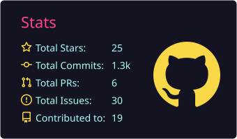
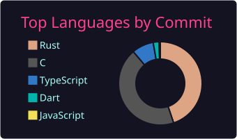
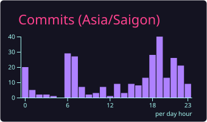
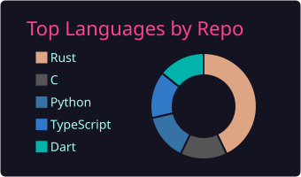

  

  

  

<picture>
  <source media="(prefers-color-scheme: dark)" srcset="https://raw.githubusercontent.com/mhieuhonda/mhieuhonda/output/github-snake-dark.svg" />
  <source media="(prefers-color-scheme: light)" srcset="https://raw.githubusercontent.com/mhieuhonda/mhieuhonda/output/github-snake.svg" />
  
</picture>

---

## 🌟 About Me

I'm **Hieu Louis** (**@mhieuhonda**), an enthusiast passionate about **AI**, **Machine Learning**, and **Deep Learning**.
I'm fascinated by how models **learn from data**, uncover **hidden patterns**, and create solutions that can genuinely **help people**.

To me, AI isn't just technology. It's a way to **turn curiosity into products** and **data into knowledge**.

---

## 🚀 What I'm Up To

<table>
<tr>
<td width="50%" valign="top">

### 🎯 Focus

- 🧠 Strong foundations in **Machine Learning** and **Deep Learning**
- 🛠️ Hands-on with **PyTorch**, **TensorFlow**, **Keras**, **Scikit-learn**
- 👁️ **Computer Vision**, **NLP**, **LLMs**, **RAG**, **Diffusion Models**
- 🚢 From notebook to production: **MLOps**, **Docker**, **APIs**

</td>
<td width="50%" valign="top">

### 🌱 Currently Learning

- 🔮 Transformer architectures
- 🎮 Reinforcement Learning
- ⚡ Model deployment and optimization
- 📊 Data-centric AI
- ⚖️ Responsible and Explainable AI

</td>
</tr>
</table>

---

## 🧰 Tech Stack

  

  

  
  
  
  
  
  

---

## 📊 GitHub Analytics

 

 

---

## 🎯 Goals

| | Goal | What it means |
|:-:|:--|:--|
| 🌍 | **Open Source** | Contribute to open-source AI/ML/DL projects |
| 🛠️ | **Build** | Build useful, accessible, and practical AI products |
| 📚 | **Share** | Share knowledge, write blogs, learn from the community |
| 🔁 | **Iterate** | Keep experimenting, failing, fixing, and improving every day |

---

## 💡 Quote I Like

> ### 💭 *"The best way to predict the future is to invent it."*
> **Alan Kay**

---

## 🤝 Let's Connect

I'm always open to talking about **AI**, **ML**, **DL**, **research**, **open source**, or any **bold idea**.

  

### ✨ *Learn from data. Build with passion. Improve every day.* ✨

